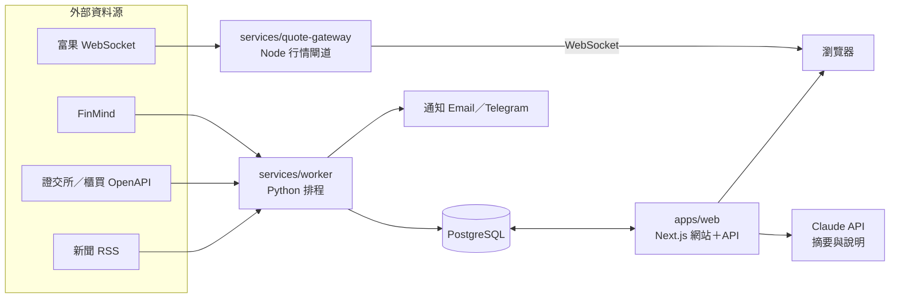

# 台股理財網站規劃書

> 定稿版本以本檔為準。線上討論版：https://claude.ai/code/artifact/2c58b0ca-aff7-419d-bc9a-081732c1b446
> 最後更新：2026-09-27

## 1. 專案概述

打造一個只給自己用的台股理財網站，把「記帳 → 看懂財務 → 看盤與追蹤持股 → 做決策」串在同一個地方。核心價值是：我的現金流、我的持股、我的學習進度都在一起，建議才能針對我的實際狀況。

**範圍**

- 市場：台股上市、上櫃個股與 ETF
- 記帳：日常收支＋投資交易（買賣、股利、手續費、證交稅）
- 使用者：單一使用者（自己），不做註冊、會員權限
- 裝置：電腦與手機瀏覽器皆可用（RWD），可安裝為 PWA

**非目標（第一版不做）**

- 自動下單、串接券商交易 API
- 自建逐筆 tick 歷史資料庫、當沖與程式交易工具
- 美股、加密貨幣（資料模型預留欄位，未來可擴充）
- 多人共用、對外公開

## 2. 功能規格

網站分五個模組，彼此共用同一份「持股」與「收支」資料。

### 2.1 投資教學

每個章節都搭配「用你自己的持股練習」，讓知識直接套用到真實資料。

| 等級 | 主題 | 實作練習 |
| --- | --- | --- |
| 初階 | 記帳與緊急預備金、股票與 ETF 是什麼、開戶與下單、手續費與證交稅、零股與定期定額、除權息、風險與分散 | 算出自己的月結餘與可投資金額；設定一檔定期定額 ETF |
| 中階 | 三大財報導讀、EPS、ROE、毛利率、月營收解讀、本益比與股價淨值比、殖利率、產業分類、K 線與均線基礎 | 挑一檔持股，從財報頁面讀出近 4 季的獲利趨勢 |
| 進階 | 現金流量與自由現金流、估值模型（DCF、本益比河流圖）、資產配置與再平衡、投資組合波動與最大回撤、三大法人籌碼、稅務（股利所得、二代健保）、行為財務學 | 用自己的持股跑一次再平衡模擬與估值 |

- 每章結尾有小測驗，記錄完成進度
- 名詞表：網站內任何財務名詞滑鼠移上去就出現解釋、連到對應章節
- 內容以 Markdown 檔管理（`apps/web/content/lessons/`），方便自己增修

### 2.2 時事與財報追蹤

- **觀察清單**：持股自動列入，另可加入感興趣的個股
- **個股頁**：股價走勢、月營收（年增、月增）、近 8 季 EPS 與三率、本益比與殖利率、歷年股利、法人買賣超
- **時事動態**：依觀察清單彙整新聞與公開資訊觀測站重大訊息
- **行事曆**：法說會、除權息日、財報與月營收公布日
- **提醒**：月營收公布、財報發布、股價觸及自訂價位、持股將除息時通知
- **每日／每週摘要**：收盤後整理持股漲跌、相關新聞與本週行事曆

### 2.3 投資建議

依我的財務狀況、風險屬性與持股產出分析與建議，詳見第 7 節。入口是一份風險屬性問卷與投資目標設定（例：10 年後累積 300 萬、每年領 12 萬股利）。

### 2.4 記帳

- **日常收支**：快速記一筆（金額、分類、帳戶、備註）、週期性收支（薪水、房租、訂閱）、預算與超支提醒、CSV 匯入銀行或信用卡對帳單
- **投資交易**：買賣紀錄自動計算手續費（可設券商折扣）與證交稅；現金股利、股票股利自動入帳；定期定額自動產生紀錄
- **報表**：每月收支、儲蓄率、淨資產走勢、持股報酬率（含息與不含息）、已／未實現損益、年度股利所得（報稅用）
- **帳戶**：銀行、現金、信用卡、證券交割戶，轉帳不重複計入收支

### 2.5 看盤

盤中即時看盤，而且直接和我的持股、成本、提醒連在一起，這是一般看盤 App 做不到的地方。

- **大盤總覽**：加權指數、櫃買指數即時走勢，類股漲跌熱力圖（面積＝成交值，顏色＝漲跌幅），漲跌家數與成交量對比昨日同時段
- **個股看盤**：分時走勢、K 線（1／5／15／60 分、日、週、月）、最佳五檔、逐筆成交明細、內外盤比
- **技術指標**：均線、成交量、KD、MACD、RSI、布林通道，可疊加多個並記住設定
- **持股連動**：K 線上標出我的買賣點與平均成本線、除權息日、財報與月營收公布日；盤中即時顯示持股總損益與今日損益
- **自選股多檔監看**：表格可自訂欄位與排序，價格跳動時短暫閃色提示；可切換「多圖並排」一次看 4／6／9 檔
- **盤中提醒**：到價、漲跌幅、爆量、跌破均線，觸發時站內通知＋手機推播
- **盤後復盤**：今日持股漲跌貢獻排行、法人動向、與我相關的新聞一頁看完

## 3. 介面設計目標

「優於現有網站與 App」定義為三件事：更快、更少干擾、資訊跟我有關；每一項都有可量測的驗收標準。

| 常見痛點 | 我們的做法 |
| --- | --- |
| 廣告、推播、付費牆佔版面 | 零廣告，資訊密度可調（精簡／標準／專業） |
| 看盤、記帳、財報分散在不同 App | 同一個畫面切換，持股成本與損益直接疊在 K 線上 |
| 功能藏在多層選單 | 指令面板：按 `/` 或 `Ctrl+K` 輸入代號或功能名稱直接跳轉 |
| 版面固定，無法依習慣調整 | 看盤頁以可拖拉、縮放的面板組成，版面可存成多組（盤中／盤後） |
| 手機與電腦體驗落差大 | 手機優先設計；可安裝成 PWA |
| 圖表卡頓、切換週期要重新載入 | Canvas 繪圖，切換週期與指標不重抓整批資料 |

**設計原則**

- 數字優先：價格、漲跌用等寬數字（`font-variant-numeric: tabular-nums`），跳動時不晃動版面
- 顏色有意義：預設台股慣例紅漲綠跌，可切換國際慣例；另提供色弱友善配色
- 深色／淺色模式，盤中預設深色
- 每個數字都能點：點 EPS 看歷年走勢、點名詞看教學說明
- 空狀態也要有用：沒有持股時顯示引導，而不是空白

**關鍵畫面**：首頁儀表板、看盤工作區、個股頁、快速記帳、報表與復盤頁。

**效能與體驗驗收標準**

| 指標 | 目標 |
| --- | --- |
| 報價從資料源到畫面 | 1 秒內 |
| 首頁首次載入（手機 4G） | 2 秒內可操作 |
| 切換個股或 K 線週期 | 300 毫秒內完成重繪 |
| 自選 50 檔同時跳價 | 維持 60 fps 不掉幀 |
| 記一筆支出 | 5 秒內、3 次點擊內 |

**如何證明比別人好**：挑 2–3 個常用的看盤與記帳 App，列出 10 個日常任務分別計時與計點擊數，每個里程碑完成後重測，結果記在 `docs/benchmarks.md`。

## 4. 資料來源

所有盤後資料由 worker 批次抓入自己的資料庫，網頁只讀本地資料。

| 來源 | 提供內容 | 限制與注意 |
| --- | --- | --- |
| [FinMind](https://github.com/FinMind/FinMind) | 日 K、本益比／股價淨值比、三大財報、月營收、股利、除權息、三大法人、融資融券 | 未登入 300 次／小時，帶 token 600 次／小時；週日凌晨維護；大量錯誤請求會暫時封鎖 IP（[政策](https://finmind.github.io/BanIPPolicy/)） |
| 證交所 OpenAPI（openapi.twse.com.tw） | 公司基本資料、月營收、損益表、資產負債表、股利、重大訊息、每日收盤與估值 | 免金鑰；多數端點只給最近資料（[整理參考](https://github.com/twjackysu/TWSEMCPServer)） |
| 櫃買中心 OpenAPI | 上櫃收盤、本益比、法人、除權息 | 格式與證交所不同，需各寫轉接層 |
| 公開資訊觀測站 | 法說會、重大訊息原文、財報 PDF | 無正式 API，只放連結 |
| 新聞 RSS | 依個股名稱與代號抓標題與連結 | 只存標題、摘要與連結，不轉載全文 |

**盤中即時行情（看盤用）**

| 來源 | 內容 | 限制與注意 |
| --- | --- | --- |
| [富果行情 API](https://developer.fugle.tw/) | REST：日內走勢、K 線、快照；WebSocket：逐筆、K 線、五檔 | 需金鑰；開發者方案每分鐘 600 次、WebSocket 可訂閱 300 檔、同時 2 條連線 |
| 券商 API（永豐 Shioaji、富邦 Neo 等） | 即時報價 | 需該券商帳戶與憑證；作為備援 |

**更新時間表**：每日約 15:00 後抓行情與法人、每日晨間抓新聞與重大訊息、每月 10 日前後抓月營收、財報季每日檢查新財報。

## 5. 系統架構

- 外部盤後資料只由 worker 寫入資料庫，網站不直接呼叫外部 API，資料源掛掉時網站仍可用
- 行情閘道是常駐服務，盤中連上富果並只訂閱自選股與持股，再推給瀏覽器；金鑰只放伺服器
- 盤中報價不寫資料庫，只快取當日分 K 供重新整理時補圖

| 層級 | 選擇 | 理由 |
| --- | --- | --- |
| 前端＋後端 | Next.js（TypeScript）、Tailwind CSS、Lightweight Charts（看盤）、Recharts（報表） | 一個專案搞定頁面與 API |
| 資料庫 | PostgreSQL（本機用 Docker，雲端可用 Supabase） | 金額需精準小數與複雜查詢 |
| 資料抓取 | Python＋FinMind＋APScheduler | FinMind 官方套件是 Python |
| 行情閘道 | Node.js＋@fugle/marketdata＋ws | 與前端同語言，富果官方 SDK |
| AI | Claude API | 新聞摘要、建議白話解釋；數字一律由程式計算 |
| 通知 | Email、Telegram Bot 或 LINE Messaging API | LINE Notify 已停止服務 |
| 部署 | Vercel＋Supabase＋小型 VPS，或全部 Docker Compose 放 NAS | 單人用量成本低 |

## 6. 資料模型

完整定義見 `db/schema.sql`。金額一律 `NUMERIC`，不用浮點數。

- 我的資料：`accounts`、`categories`、`transactions`、`recurring_rules`、`budgets`、`trades`、`dividends_received`、`holdings`（檢視）、`watchlist`、`alerts`、`investor_profile`、`lesson_progress`
- 市場資料：`securities`、`daily_prices`、`monthly_revenue`、`financials`、`dividend_events`、`institutional_flows`、`news_items`、`events_calendar`

## 7. 投資建議引擎

建議由「可解釋的規則」產生，AI 只負責把規則結果寫成白話；每則建議都附上觸發它的數字與規則。

| 層級 | 檢查什麼 | 規則範例（閾值可自訂） |
| --- | --- | --- |
| 1. 財務健康 | 緊急預備金、儲蓄率、負債 | 預備金低於 6 個月支出 → 先補足；儲蓄率連 3 個月低於 20% → 檢視前三大支出 |
| 2. 資產配置 | 實際 vs 目標配置 | 股票比重偏離目標超過 5 個百分點 → 提出再平衡金額 |
| 3. 投資組合風險 | 集中度、產業曝險 | 單一個股超過 20%、單一產業超過 40% → 集中風險提醒 |
| 4. 個股健檢 | 基本面與估值 | 月營收年增率連 3 個月負成長、毛利率連 2 季下滑、本益比高於自身 5 年區間上緣 → 需要關注 |

- 首頁「本週建議」最多 5 則，依層級排序，附觸發數字、下一步與教學連結
- 個股頁「健檢卡」：成長、獲利、財務安全、估值、股利穩定五項燈號
- 投資日誌：買賣時記下理由，每季回顧是否仍成立
- 不預測短期股價；所有數字由程式計算；規則與閾值可在設定頁調整

## 8. 里程碑

每週約 8–10 小時，全部約 21 週。

| 階段 | 週數 | 產出 | 完成標準 |
| --- | --- | --- | --- |
| M0 原型與基礎建設 | 2 | 可點擊原型、專案骨架、登入、資料庫、部署流程 | 原型試用一週後定稿 |
| M1 記帳 | 3 | 帳戶、收支、轉帳、週期性收支、預算、CSV 匯入、月報表 | 連續記帳一個月，餘額與銀行對得上 |
| M2 投資記帳 | 2 | 買賣、手續費與稅、股利、持股與報酬率 | 持股成本與券商對帳單一致 |
| M3 市場資料 | 3 | worker、行情、月營收、財報、除權息、個股頁、觀察清單 | 連續 2 週每日自動更新無中斷 |
| M4 看盤 | 4 | 行情閘道、大盤總覽、個股看盤、技術指標、持股連動、多圖並排、盤中提醒 | 達到效能驗收標準 |
| M5 時事與提醒 | 2 | 新聞、AI 摘要、行事曆、通知、每日摘要 | 持股公布月營收當天收到通知 |
| M6 建議引擎 | 3 | 風險問卷、四層規則、健檢卡、投資日誌 | 每則建議可追溯到規則與數字 |
| M7 教學 | 2 | 課程框架、初階章節、名詞表、測驗 | 初階完成，中進階有大綱 |

## 9. 風險與待決事項

| 風險 | 對策 |
| --- | --- |
| 免費資料源改版或限流 | 每個來源獨立轉接層；互為備援；抓取失敗通知自己 |
| 建議規則誤導 | 建議只是檢查清單，附觸發數字；定期回顧準確度 |
| 財務資料外洩 | 強密碼＋雙因素、HTTPS、每日備份；不存券商或銀行密碼；金鑰只放 `.env` |
| AI 摘要編造內容 | 永遠附原文連結；數字一律來自資料庫 |
| 手續費、稅率變動 | 費率放設定檔，不寫死 |
| 即時行情額度不足 | 只訂閱自選與持股；斷線自動重連並顯示「延遲中」 |
| 看盤效能不如預期 | M0 就用真實跳價壓測 50 檔；圖表增量更新 |

**法規**：只給自己用，屬個人分析工具。若未來開放他人或收費，對不特定人提供個股建議可能涉及證券投資顧問業務，需先請教律師。

**待決事項**

- [ ] 部署在雲端還是家中 NAS？
- [ ] 通知管道選 Email、Telegram 還是 LINE Messaging API？
- [ ] 使用哪家券商？手續費折扣？對帳單能否匯出 CSV？
- [ ] 目標資產配置比例與投資目標金額
- [ ] 教學內容自己寫、AI 草擬後校對，還是連到外部資源？
- [ ] 即時行情用富果（預算？）還是自己券商的 API？
- [ ] 比較基準用哪 2–3 個 App？
